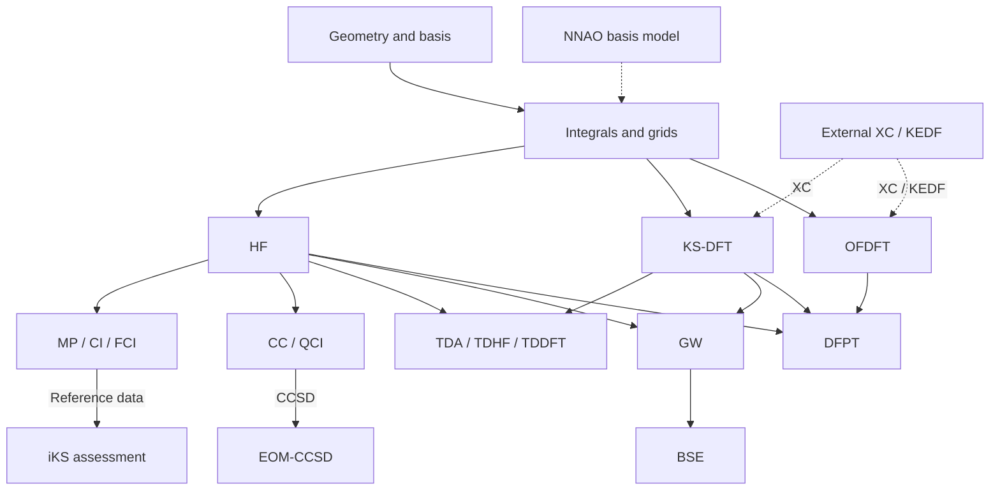

# GradSCF

**Differentiable electronic structure in JAX.**

GradSCF is a Python framework for molecular and periodic electronic-structure
calculations, response theory, and learning within self-consistent calculations.
It brings HF/DFT, correlated wavefunctions, GW/BSE, and external energy and basis
models into a common differentiable framework. Physical methods define their
energies, operators and residuals; shared numerical solvers provide forward
solutions and the corresponding response rules.

[Tutorials: English](https://stokes-dot.github.io/GradSCF_Tutorials/en/) ·
[教程：简体中文](https://stokes-dot.github.io/GradSCF_Tutorials/zh_CN/) ·
[Methods](#supported-methods) · [Differentiation](#differentiation) ·
[Learning](#learning-with-gradscf) · [Installation](#installation) · [Citation](#citation)

## Highlights

- **Electronic structure and learning in one framework.** Ground states,
  excited states, quasiparticles and response properties can be composed with
  user-defined objectives and external models through JAX.
- **Derivatives of physical solutions.** Differentiate supported converged SCF,
  correlated-state and spectral problems using explicit computation or implicit
  response. Shared derivative rules include validity conditions for convergence,
  occupations and spectral separation.
- **External functionals with user-defined inputs.** Traditional formulas and
  neural networks supply scalar XC or kinetic energies. GradSCF updates their
  physical inputs during self-consistency and derives potentials and response
  actions from the same energy definition.
- **Learnable Gaussian basis sets.** NNAO models connect environment-dependent
  Gaussian contractions and supported exponent parameters to electronic
  energies, with normalization and parameter-response contracts.
- **Memory-aware execution.** Exact packed integrals, shell-direct J/K,
  auxiliary-basis RI, selected AO-to-MO blocks, streamed grids and matrix-free
  molecular response offer alternatives to full tensor storage. Response
  batches, workspaces and eigensolver subspaces share a planning budget.
- **Reusable numerical infrastructure.** HF/KS methods share SCF iteration
  machinery; electronic-structure modules reuse linear, nonlinear and
  Hermitian/non-Hermitian eigenvalue solvers instead of maintaining independent
  forward and backward implementations.
- **Calculation objects and functional APIs.** Familiar method-oriented objects
  support interactive calculations; array-level interfaces support JIT, automatic
  differentiation and custom research workflows.

Solid arrows show reference/preparation paths; dashed arrows show external-model
inputs. Gaussian AO integrals use libcint; periodic grids and pseudopotentials
retain their FFT/GTH paths. iKS here denotes fixed-reference functional
assessment. The diagram summarizes available connections, not uniform derivative
or device coverage across every method.

## Supported methods

Forward availability, derivative coverage, and physical accuracy are separate.
The MP/CI/CC/EOM entries describe molecular calculations; periodic methods
have their own reference, solver and response contracts.

| Family | Available calculations | Reference / scope and guide |
| --- | --- | --- |
| Molecular HF/DFT | RHF/UHF/ROHF/GHF; RKS/UKS/ROKS/GKS; UHF/UKS stability | [SCF](src/gradscf/scf), [DFT](src/gradscf/dft); closed-shell HF uses `scf.RHF` |
| Periodic HF/DFT | Gamma/k-point calculations, GTH, FFT density fitting, bands | [Periodic modules](src/gradscf/pbc); method-specific periodic contracts |
| MP | MP2/MP3 and order-driven MPn; frozen orbitals, E2 spin components | [MP](src/gradscf/mp/README.md), [Taylor series](src/gradscf/mp/SERIES.md); real canonical RHF/UHF, capacity-limited high-order engine |
| CI | Singlet/triplet CIS, singlet CIS(D), spin-conserving UCIS, rank-truncated CI | [CI](src/gradscf/ci/README.md); real RHF/UHF/ROHF determinant spaces |
| FCI | Complete occupation-string spaces, core/active selection, RDMs, transition RDMs, spin diagnostics | [FCI](src/gradscf/fci/README.md); real common spatial orbitals, integer spin populations |
| CC/QCI | CCS/CCD/CCSD/CC2/LCCD/LCCSD, QCISD, CCSD(T)/QCISD(T), Lambda, 1/2-RDMs | [CC](src/gradscf/cc/README.md); restricted models and UCCSD/UCCD; model-specific properties |
| EOM-CCSD | EE singlet, IP/EA doublet energies, left/right states, first-order response | [EOM](src/gradscf/cc/eom/README.md); real restricted CCSD reference |
| TDHF/TDDFT | TDA/full response, transition properties and spectra; periodic q=0 response | [Molecular facade](src/gradscf/tdscf), [periodic response](src/gradscf/pbc/tdscf.py) |
| GW | Molecular G0W0-CD, evGW0, evGW, restricted qsGW/matrix Matsubara scGW; Gamma/k-point GW | [GW](src/gradscf/gw), [scGW](src/gradscf/gw/SCGW.md), [periodic GW](src/gradscf/gw/pbc) |
| BSE | Static TDA/full optics, singlet/triplet and unrestricted spin-conserving sectors | [BSE](src/gradscf/bse/README.md); molecular reference and screening conventions |
| OFDFT | Molecular/periodic Gaussian amplitudes and FFT grids; TF, vW, TF+vW, WT, WGC99, external KEDFs | [OFDFT](src/gradscf/ofdft/README.md); unpolarized density, WT/WGC periodic only |
| DFPT | Static molecular/periodic KS and OFDFT response; Taylor response series and supported finite-q perturbations | [DFPT](src/gradscf/dfpt/README.md); converged-reference, k-mesh and perturbation contracts |
| Inverse KS references | RKS/UKS/GKS density targets and local-potential maps; finite-temperature matrix references; fixed-reference functional assessment | [iKS](src/gradscf/dft/iks/README.md); explicit finite-basis reference method, zero-temperature Wu–Yang/coupled inverse-GKS unfinished |
| Vibrational coupling | Fan/Debye–Waller self-energies, spectra, exciton–vibration optics, finite-space vibronic Hamiltonians | [GW EP](src/gradscf/gw/ep_coupling/README.md), [BSE EP](src/gradscf/bse/ep_coupling/README.md); fixed bath, BSE projection restricted TDA |

Canonical real UHF CCSD(T), UCC Lambda and spin-resolved densities are available.
The [semicanonical triples option](src/gradscf/cc/SEMICANONICAL.md) supports its
specified noncanonical references through a tensor resolvent. ROHF-based UCCSD
uses unrestricted amplitudes on common orbitals, not a separate spin-adapted
ROCCSD formulation. See [open-shell scope](src/gradscf/cc/OPEN_SHELL.md).

FCI active spaces provide a foundation for future multireference drivers;
CASSCF orbital optimization is not implemented. Fixed-phonon GW/BSE coupling
has no self-consistent phonon feedback; Matsubara scGW has no analytic continuation.

## Differentiation

GradSCF treats the derivative of a converged electronic problem as part of the
method. Implicit response differentiates its stationarity, fixed-point or
spectral equations; explicit differentiation follows the supported JAX
computation. Geometry, basis and model parameters retain their dependencies
through the integral, grid and electronic-response layers where implemented.

| Differentiable object | Response and scope |
| --- | --- |
| SCF states and energies | Explicit JAX computation or implicit stationary/fixed-point response; requires a converged state and the corresponding integral/XC products |
| Correlated energies and amplitudes | Specialized MP kernels, residual-driven Taylor series, CI/FCI spectral response and CC nonlinear-root response |
| Excitation and quasiparticle energies | Shared TDA/RPA/EOM spectral rules and implicit molecular GW roots; outer self-consistency has method-specific contracts |
| Geometry, basis and external-model parameters | Operator-specific integral JVP/VJP composed with grid, functional and electronic response; supported derivative order depends on the complete path |

Internal degeneracy can permit derivatives of **complete-subspace projectors
and energy sums** when that space is separated from excluded states. An
individual sorted eigenvalue or arbitrary eigenvector need not have a unique
derivative. The shared [spectral response guide](src/gradscf/solvers/DEGENERACY.md)
defines these distinctions for Hermitian and supported non-Hermitian problems.

Derivative coverage is not implied by forward availability. Full nuclear
response includes orbital, integral, grid and XC contributions; higher and mixed
derivatives require a validated complete path. The generic facade nuclear-gradient
method remains disabled; supported array-level workflows are documented in the
[integral contracts](src/gradscf/integrals/README.md),
[GW response guide](src/gradscf/gw/OUTER_RESPONSE.md), and tutorials.

## Learning with GradSCF

**External XC and kinetic-energy functionals.** Users define the physical inputs,
network architecture and scalar energy. The functional interface supplies current
SCF density information, including supported grid derivatives and kinetic-energy
density. Differentiating the full feature-to-energy graph produces the AO
potential and response action. Global or neural callbacks retain their declared
nonlocal dependence. Traditional XC recipes and external models share the
[functional interface](src/gradscf/dft/FUNCTIONAL.md); available conventional
functionals are listed in the [XC library](src/gradscf/dft/xc/README.md).

Three training modes support different objectives:

| Mode | Role |
| --- | --- |
| Fixed density | Fit an energy functional or its supported derivatives on supplied reference states |
| Explicit | Differentiate the supported JAX SCF computation |
| Implicit | Differentiate the converged SCF fixed-point condition |

The [training guide](src/gradscf/model/neural_xc/training/README.md) specifies
reference labels, losses and update acceptance. Models own their architectures,
training and checkpoints; shared physical modules own SCF and response solvers.

**Neural basis sets.** [NNAO](src/gradscf/model/nnao/README.md) maps MACE outputs
to normalized Gaussian contractions. Fixed-primitive direct J/K and RI paths
support contraction optimization; contracted workflows also optimize supported
log-exponent scales. Coefficient, exponent, geometry and force-loss derivatives
have distinct contracts. Optimization on a training set does not establish
transferability.

**Inverse-reference assessment.** [iKS](src/gradscf/dft/iks/README.md) supplies
RKS/UKS/GKS density targets and local-potential maps for assessing analytical or
neural functionals. Its selected finite-temperature matrix reference supports
fixed-reference energy/operator training. Inverse-map AD/JIT, zero-temperature
Wu–Yang and coupled inverse-GKS optimization remain unfinished.

## Numerical infrastructure and execution

**One Gaussian integral interface.** The [libcint integral layer](src/gradscf/integrals/README.md)
provides full and packed integrals, shell-direct J/K, and explicit auxiliary RI.
JAX handles normalization, AO/grid evaluation, contractions and differentiation.
Necessary scalar ECP extensions retain their own provenance and licenses.
[Shared AO-to-MO transformations](src/gradscf/ao2mo/README.md) supply the selected
blocks needed by correlated and response methods.

**Memory planning without changing the requested physics.** Molecular
TDA/full TDDFT uses matrix-free AO-density or DF actions with shared Davidson/RPA
solvers. Streamed AO grids and reusable MO grid fields reduce repeated
preparation. The memory budget controls block sizes, trial-vector batches,
workspace and subspaces; it does not lower the grid level or truncate the
occupied/virtual space. The default response budget is 60000 decimal MB and is
a planning budget rather than a process-RSS limit.

Packing is exact; RI introduces an auxiliary-basis approximation. Some
correlated paths still expand inputs into full MO tensors, and explicitly
requested complete four-index outputs remain quartic. Available input formats
therefore do not imply the same storage or scaling for every method.

**Explicit CPU/GPU boundaries.** Libcint integral preparation executes on CPU;
supported JAX contractions and solvers can execute on GPU. Molecular RKS/UKS
with explicit auxiliary RI can stage a prepared CPU reference onto GPU for
supported response calculations and reuse its resident data. This does not
establish complete GPU or traced RI geometry-derivative coverage.

**Compilation reuse with live physical inputs.** Compatible molecular response
calculations reuse compiled numerical programs while orbitals, integrals and
external XC parameters remain dynamic. Physical data preparation and compilation
are separate concerns. Performance and memory depend on the method,
representation, grid, solver and device; no universal acceleration is claimed.

See the [shared solver guide](src/gradscf/solvers/README.md) and
[response execution measurements](reports/tddft_execution_fix/20261027-d67ce6c/report.md)
for implementation scope and measured workloads.

## Tutorials and documentation

The bilingual [GradSCF Tutorials](https://github.com/STOKES-DOT/GradSCF_Tutorials)
cover theory, computational graphs, public method calls and validated
calculation examples. Installation, executable code and step-by-step workflows
are maintained there rather than repeated in this README.

| Resource | Purpose |
| --- | --- |
| [English tutorials](https://stokes-dot.github.io/GradSCF_Tutorials/en/) / [中文教程](https://stokes-dot.github.io/GradSCF_Tutorials/zh_CN/) | Foundations, method usage, properties, development and machine learning |
| [Public API](API.md) | Calculation objects and array interfaces |
| [Examples](examples/README.md) | Runnable scripts grouped by method and task |
| [Migration guide](MIGRATION.md) / [import table](API_MIGRATION.csv) | Changes to public imports and interfaces |
| [Model development](src/gradscf/model/README.md) | External-model integration, ownership and training contracts |
| [Changelog](CHANGELOG.md) | Versioned changes |

Tutorial results identify their source revisions and numerical settings; a
recorded example is not a claim of validation for every current configuration.

## Installation

GradSCF is installed from source on Linux or macOS. The package requires
Python 3.10+; repository tests use Python 3.11+. The bundled native integral
library requires CMake 3.20+, a C99/C++17 compiler and BLAS. No upstream source
is downloaded during the native build. See the tutorials and
[native build guide](src/gradscf/integrals/_native/README.md) for setup.

Optional extras provide conventional XC (`upstreams`, including jax-xc),
reference comparisons (`comparison-tests`), neural basis dependencies (`nnao`),
and plotting/evaluation tools (`reproducibility`). PySCF is an optional
independent comparison program, not a production Python integral dependency.

## Validation and contributing

Validation combines independent reference calculations, reconverged directional
finite differences, original-operator residuals, normalization, symmetry and
conservation checks. Method guides record systems, bases/functionals, units,
tolerances and device/derivative boundaries. See the validation records for
[MP](src/gradscf/mp/VALIDATION.md), [CI](src/gradscf/ci/VALIDATION.md),
[FCI](src/gradscf/fci/VALIDATION.md), [CC](src/gradscf/cc/VALIDATION.md),
[EOM](src/gradscf/cc/eom/MOLECULAR_VALIDATION.md),
[solvers](src/gradscf/solvers/VALIDATION.md), and
[OFDFT/WGC](examples/ofdft/WGC_REPRODUCTION.md).

These records establish scoped numerical and derivative checks, not uniform
method maturity, GPU support or physical accuracy. Performance comparisons
require matching workloads, precision, convergence and compilation policies.

Report bugs through [GitHub Issues](https://github.com/STOKES-DOT/GradSCF/issues)
with a minimal reproducer, commit/version, device, dtype, geometry/units,
basis/XC and convergence information. Contributions should preserve physical
and solver boundaries, add focused numerical regressions and retain upstream
notices.

## Citation

Identify the repository and commit/version used in published calculations.
Cite the methods and upstream software relevant to your calculation; references
and attribution are maintained in
[MP](src/gradscf/mp/REFERENCES.md), [CI](src/gradscf/ci/REFERENCES.md),
[FCI](src/gradscf/fci/REFERENCES.md), [CC](src/gradscf/cc/REFERENCES.md),
[BSE](src/gradscf/bse/REFERENCES.md), and [GW](src/gradscf/gw/__init__.py).

## License and acknowledgments

Original GradSCF code uses the [MIT license](LICENSE). Foundational DFT/TDDFT
code originates from [GradTDDFT](https://github.com/STOKES-DOT/GradTDDFT).
Adapted/vendored components retain their own notices and licenses:
[PySCF CC contractions](src/gradscf/cc/NOTICE.md),
[native integral and ECP sources](src/gradscf/integrals/_native/README.md),
[OFDFT/libKEDF](src/gradscf/ofdft/LICENSE.libKEDF), and
[MACE-JAX provenance](src/gradscf/model/nnao/vendor/mace-jax/UPSTREAM.json).
