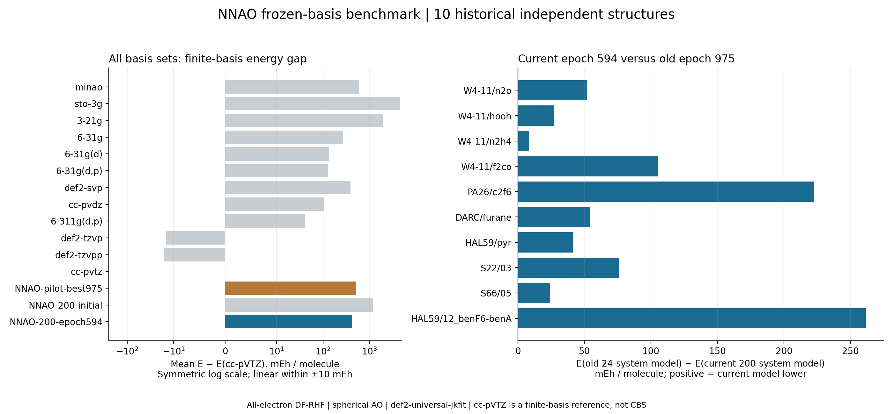

# 当前200体系模型与历史基组benchmark对比

冻结任务96984的最佳检查点：epoch 594，SHA256 `904d2ef27d3fd54be0fba5c34d4d94beabecfb82db9d368f4c94a29f47b52b16`。测试期间没有拟合、梯度更新或优化器更新。

沿用历史10个测试结构，重新计算12个传统基组、旧24体系best975、当前200体系epoch594，以及当前指数池的初始收缩。共150项GPU4PySCF计算和20项当前NNAO的GradSCF原生计算。
测试结构ID及整体分子式与当前200训练结构无交集；这不保证片段或反应关联独立。

统一全电子RHF、球谐AO、float64、def2-universal-jkfit；hcore初猜，conv_tol=1e-12 Eh、conv_tol_grad=1e-9、max_cycle=200。失败后允许0.2 level shift，最终须在原始Fock上收敛。当前NNAO原生路径还检查内部稳定性；同基组GPU4PySCF能量必须在1e-7 Eh内一致。

全部150项比较有效。当前NNAO原生/GPU4PySCF最大能量差为 1.444e-11 Eh。硬件：Tesla V100-SXM2-32GB，Slurm作业 97504，32 CPU。

当前模型相对旧24体系模型平均降低 87.389 mEh/体系；相对当前指数池初始收缩平均降低 786.638 mEh/体系。正值表示当前模型能量更低。

| 体系 | NNAO AO / Fock尺寸 | 旧24 − cc-pVTZ / mEh | 当前200 − cc-pVTZ / mEh | 当前相对旧24降低 / mEh |
|---|---:|---:|---:|---:|
| W4-11/n2o | 30 / 30×30 | 319.168 | 267.031 | 52.137 |
| W4-11/hooh | 28 / 28×28 | 210.515 | 183.322 | 27.193 |
| W4-11/n2h4 | 36 / 36×36 | 139.144 | 130.745 | 8.399 |
| W4-11/f2co | 40 / 40×40 | 547.997 | 442.530 | 105.467 |
| PA26/c2f6 | 80 / 80×80 | 1165.351 | 942.732 | 222.619 |
| DARC/furane | 66 / 66×66 | 290.009 | 235.463 | 54.546 |
| HAL59/pyr | 80 / 80×80 | 295.267 | 254.047 | 41.220 |
| S22/03 | 76 / 76×76 | 553.639 | 477.278 | 76.360 |
| S66/05 | 72 / 72×72 | 269.617 | 245.276 | 24.341 |
| HAL59/12_benF6-benA | 120 / 120×120 | 1321.042 | 1059.436 | 261.605 |

| 基组 | 平均AO数 | 平均相对cc-pVTZ能量差 / mEh | 当前模型能量更低的体系数 |
|---|---:|---:|---:|
| minao | 28.7 | 602.579 | 8/10 |
| sto-3g | 28.7 | 4655.305 | 10/10 |
| 3-21g | 52.2 | 1969.359 | 10/10 |
| 6-31g | 52.2 | 268.429 | 0/10 |
| 6-31g(d) | 78.2 | 135.607 | 0/10 |
| 6-31g(d,p) | 86.3 | 127.130 | 0/10 |
| def2-svp | 86.3 | 391.382 | 5/10 |
| cc-pvdz | 86.3 | 106.089 | 0/10 |
| 6-311g(d,p) | 109.8 | 40.879 | 0/10 |
| def2-tzvp | 177.4 | -14.378 | 0/10 |
| def2-tzvpp | 199.0 | -16.257 | 0/10 |
| cc-pvtz | 193.8 | 0.000 | 0/10 |
| NNAO-pilot-best975 | 62.8 | 511.175 | 10/10 |
| NNAO-200-initial | 62.8 | 1210.424 | 10/10 |
| NNAO-200-epoch594 | 62.8 | 423.786 | — |

当前和旧模型的训练轮数、训练数据及指数池均不同，本比较评价完整基组表现，不能把差异单独归因于训练样本数量。cc-pVTZ仅为同几何有限基组DF-HF参照，不是CBS；结果不能直接推广到力、BSSE或完整GMTKN55。
计时数据在all-results.csv中；JAX首次调用含编译，GPU4PySCF首次kernel含DF准备，两个后端计时范围不同，不计算速度比。

