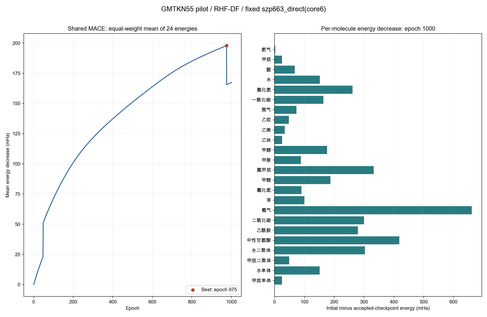

# GMTKN55 首批共享 NNAO 训练结果

快照生成时间：2026-10-07T07:30:49.947894+00:00；状态：**已完成**。
请求 **1000 epochs**，当前已接受 **1000 epochs**，包含 epoch 0 和 1000 次完整 batch Adam 更新。

## 实测结果

24 条训练结构的等权平均能量从 **-113.910510940696 Ha** 到 **-114.077821167784 Ha**，下降 **167.310227 mHa**。
最后有效参数：epoch **1000**；最优平均能量参数：epoch **975**，loss **-114.108449834830 Ha**。
两者分别来自 `last.npz` 与 `best.npz`，能量和逐分子诊断来自各自参数的实际 SCF 评估；best 表示全体均值最小的共享参数，不表示每个分子独立的能量最优值。
24/24 个结构相对初始点降能；逐结构变化为 2.609695 至 661.331622 mHa。均值目标允许不同结构间发生权衡。
训练进程记录耗时：1705.01 s。 已记录的 1000 个更新 epoch 中，耗时中位数为 1.280 s（包含评估、优化与检查点写入；不包含 epoch 0 的初始编译评估）。

| 体系 | AO 数 | 初始能量 / Ha | 当前有效能量 / Ha | 降能 / mHa |
|---|---:|---:|---:|---:|
| 氢气 | 8 | -1.125495610 | -1.128105305 | 2.6097 |
| 甲烷 | 26 | -40.159891255 | -40.184581183 | 24.6899 |
| 氨 | 22 | -56.087155405 | -56.155199113 | 68.0437 |
| 水 | 18 | -75.812708388 | -75.964429973 | 151.7216 |
| 氟化氢 | 14 | -99.643752241 | -99.904907031 | 261.1548 |
| 一氧化碳 | 20 | -112.413222924 | -112.576760534 | 163.5376 |
| 氮气 | 20 | -107.955458999 | -108.029067201 | 73.6082 |
| 乙烷 | 44 | -79.152600310 | -79.200710114 | 48.1098 |
| 乙烯 | 36 | -77.945388691 | -77.979362471 | 33.9738 |
| 乙炔 | 28 | -76.737882142 | -76.763604503 | 25.7224 |
| 甲醇 | 36 | -114.779294900 | -114.955582750 | 176.2879 |
| 甲胺 | 40 | -95.068997659 | -95.157199217 | 88.2016 |
| 氟甲烷 | 32 | -138.578628683 | -138.911041110 | 332.4124 |
| 甲醛 | 28 | -113.568403507 | -113.755528648 | 187.1251 |
| 氰化氢 | 24 | -92.682887704 | -92.772984543 | 90.0968 |
| 苯 | 84 | -230.437666981 | -230.537979411 | 100.3124 |
| 氟气 | 20 | -196.974698848 | -197.636030470 | 661.3316 |
| 二氧化碳 | 30 | -187.106562197 | -187.406671002 | 300.1088 |
| 乙酰胺 | 60 | -207.530233988 | -207.809850035 | 279.6160 |
| 中性甘氨酸 | 70 | -282.165658276 | -282.584220609 | 418.5623 |
| 水二聚体 | 36 | -151.633028633 | -151.936270653 | 303.2420 |
| 甲烷二聚体 | 52 | -80.319468932 | -80.368481411 | 49.0125 |
| 水单体 | 18 | -75.813233627 | -75.964563453 | 151.3298 |
| 甲烷单体 | 26 | -40.159942676 | -40.184577288 | 24.6346 |

第976轮平均能量回升32.430721 mHa，主要来自N₂能量增加0.779890 Ha；前后SCF均报告收敛，且都是11个周期。此次只定位到发生变化的结构，尚未核查其基组系数、轨道/密度及解分支，不能确定跳变原因。

## 方法、目标与作用范围

本轮是 **一套共享 MACE 参数** 的训练，共 7171 个参数；全部 24 条 GMTKN55 v2 中性、spin=0、CHNOF 结构都参与训练，**没有 held-out 集**。
loss 为 `mean(E_RHF,DF)`，单位 Hartree，全部结构等权。GMTKN55 参考能量、反应标签、拟合误差不进入 loss；没有额外正则项。
基组为球谐 `szp663_direct/core6`、全电子无 ECP。固定几何、primitive 指数与内层；MACE 学习价层及多 primitive 极化壳的收缩系数，包括 H 的 p 壳和重原子的 d 壳。
MACE：channels=8、interaction=2、max_ell=1、correlation=2、zero_init=True、seed=0。
每个 epoch 在同一共享参数处重收敛全部 24 次 SCF，平均梯度后执行一次 `Optax clip_by_global_norm(1.0) + Adam`，学习率 `0.0001`。
SCF：max_cycle=150、能量容差 1e-12 Ha、密度容差 1e-10、轨道梯度容差 1e-09。
backward 是收敛密度固定点 implicit SCF，线性求解 tolerance=1e-08、max_iter=100、restart=40。
独立模型的 24 体系 FD/5 步 Adam 是训练前验证阶段；本报告只统计之后的共享模型训练阶段，二者结果不混合。
训练前验证 24/24 通过，失败 0；收缩系数/网络参数方向 FD 的最大绝对误差分别为 3.885e-09 / 4.070e-09。

## 硬件、后端与复现记录

`jy_gpu_2` / 节点 `n002` / Slurm `93108`；GPU `Tesla V100-SXM2-32GB`；JAX backend `gpu`，设备 `cuda:0`。
申请单 GPU、16 CPU、64 GiB、4 小时；固定 primitive S/H 与压缩 DF factors 来自 native CPU 缓存，辅助基 `def2-universal-jkfit`，GPU 执行收缩、SCF、MACE 与反传。没有保存完整四指标 ERI。
参数向量 dtype `float64`，RHF 积分/计算 dtype `float64`；Python 3.11.15；e3nn-jax 0.21.0, flax 0.12.7, jax 0.10.0, jaxlib 0.10.0, mace-jax 0.2.0, optax 0.2.8。
运行命令与分配见 `../run_train.sbatch`；完整配置、源码导入位置与每个 DF cache SHA-256 见 `../training-93108/metadata.json`，逐分子数值见 `metrics.csv`。

## 检查与证据边界

每个接受步骤检查 SCF converged、轨道残差 ≤1e-7、最小 overlap 特征值 ≥1e-8、能量重构误差 ≤1e-9 Ha，且能量和梯度有限；失败即停止，不隐藏剔除结构。
当前检查点的最大轨道残差为 1.416e-09，最大重构误差为 2.842e-14 Ha。
本结果证明已选训练样本上的变分能量优化；不据此宣称泛化性能、double/triple-zeta 水平、轨道稳定性或全局最低 HF 解。DF 近似与固定 primitive 池也是适用范围的一部分。
`last.npz` 与 `best.npz` 保留参数、完整 Adam state/counter、梯度和其对应的完整接受历史；恢复要求数据、源码、模型、缓存和优化配置一致。

## 数据与源码 SHA-256

- `experiment_source_sha256`：`597f0023182032aeeb52984b776bc7e42d8153075c89c0e9289afb71600c3976`
- `scientific_source_sha256`：`7df11aecdbf295818de02c0db67da3de8d3db5b1ccef29798114308e28d08ebb`
- `source_sha256`：`1e0769c5f55edeaaeb9da637e28af4c91937592352dc323ac6d967073fe43fd3`
- `structures_sha256`：`cddae74070ee5053656c1e105be45e0b8dbd98ab15ec347d0fc87e4233405899`
- `validation_source_sha256`：`a8dd1c966886a17244245927b046dc7c8ecb6a704021eb6e4dce690cef00cab1`
- `validation_summary_sha256`：`f65c4cddd0d25367ebcbc4178f7304443b886ece25fe63799ea7463eb8d1a361`

最后参数数组 SHA-256：`13660ebb2b8c0981e229bbc90b58dc5b0bd3ce43b89c278e14bd7155cc80ea13`；best 参数数组 SHA-256：`cfc7d43cc57f5a1a234d782a7849903a19b41c2b90864e2774d7ca962acd5a6a`。
