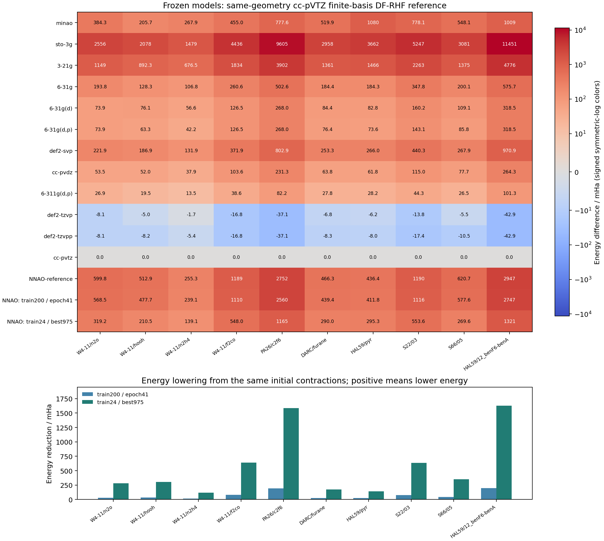
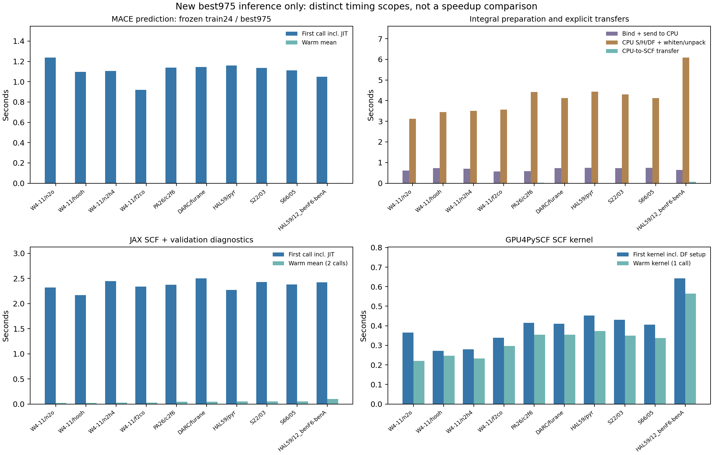

# 旧24体系最佳快照的独立 HF 测试

**本次只使用旧24体系共享 MACE 的 best.npz（epoch975），冻结推理，没有继续训练或更新参数。** 它与从头训练的200体系模型（epoch41）是两套不同权重，不能称为200体系模型的1000轮结果。

复用已完成的作业95106中12个传统基组、初始NNAO和200体系epoch41结果；原始JSON字节哈希均核验。新测量仅包含10个pilot-best975 native／GPU4PySCF同基组验证，共合并为15基组×10结构。

旧best975有效能量 **10/10**，0项失败、0项尚无结果；失败或后端不一致的计算不计分。Native／GPU4PySCF同基组最大误差为 1.501e-11 Ha。

结构仍为先前10个选定测试体系，结构ID、坐标及整体分子式排除了200训练／50验证／24pilot及旧苯胺。不保证片段、化学图或反应关联隔离。统一球谐、全电子、float64、DF-RHF、def2-universal-jkfit；几何、SCF阈值和hcore初始化不变。NNAO AO与primitive池规模逐体系核对一致。

| 结构 | NNAO AO / primitive AO | best975 − cc-pVTZ / mHa | 相对初始降低 / mHa | 相对200体系epoch41降低 / mHa | 状态 |
|---|---:|---:|---:|---:|---|
| W4-11/n2o | 30 / 135 | 319.17 | 280.67 | 249.38 | passed |
| W4-11/hooh | 28 / 114 | 210.52 | 302.42 | 267.21 | passed |
| W4-11/n2h4 | 36 / 138 | 139.14 | 116.14 | 100.00 | passed |
| W4-11/f2co | 40 / 180 | 548.00 | 640.55 | 561.51 | passed |
| PA26/c2f6 | 80 / 360 | 1165.35 | 1586.42 | 1394.76 | passed |
| DARC/furane | 66 / 273 | 290.01 | 176.30 | 149.36 | passed |
| HAL59/pyr | 80 / 330 | 295.27 | 141.16 | 116.54 | passed |
| S22/03 | 76 / 318 | 553.64 | 636.83 | 562.29 | passed |
| S66/05 | 72 / 276 | 269.62 | 351.13 | 307.97 | passed |
| HAL59/12_benF6-benA | 120 / 540 | 1321.04 | 1625.68 | 1426.44 | passed |

仅按有效独立测试结果，best975相对初始平均降低 **585.73 mHa**；相对200体系epoch41平均降低 **513.54 mHa**。正值表示旧best975能量更低，负值表示更高。这些数值来自本次测试，未使用旧24训练均值作为得分。

按逐体系实际能量，best975低于传统基组的结构数为：minao 6/10；3-21g 10/10；6-31g 0/10；cc-pvdz 0/10。

两个当前检查点的结果支持旧24体系best975优于新200体系epoch41，但优化轮数不同，不能将这项差异归因于24个训练样本比200个更有效。相对6-31G仍平均高242.75 mHa；目前的HF总能量结果不支持达到常规double-/triple-zeta水平。

参照为同几何cc-pVTZ有限基组DF-HF能量，非CBS、非GMTKN55高精度标签；不是完整GMTKN55或WTMAD2评估。不能由能量降低推断力、BSSE或能力上限。此次没有测试旧last1000，也没有解释旧训练epoch976的N2跳变。

计时图只报告新best975前向：基组绑定／到CPU、CPU积分及DF白化解包、到SCF设备传输分开记录；MACE和JAX首调用包含编译，native solve还含能量重构、S最小特征值、commutator及raw-Phi验收。GPU4只对mf.kernel计时，其诊断在计时外；冷热SCF都独立从hcore开始，不计算后端speedup。新旧两次硬件均核对为Tesla V100-SXM2-32GB。

## 运行与复现记录

作业95119在`jy_gpu_2` / Delta的n002上分配1张V100 32GB、16个CPU核和128 GiB内存，于2026-10-10 10:53:49（北京时间）结束，退出码0。新975模型完整native阶段耗时110.83 s，完整GPU4PySCF阶段耗时9.75 s；均包含重复独立SCF，单次分阶段耗时见CSV。检查点字节保持不变，旧模型127文件映射和当前764文件源码分别核验。

```bash
cd /home/user_yuanjiao/private/homefile/GradSCF
sbatch artifacts/nnao-heldout-benchmark-20261010/run_pilot_best975.sbatch
```

该脚本明确使用`pilot-best975`身份和`trained`变体，只读取原best.npz；先完成N₂O跨后端检查，再执行10体系复测。传统基组和初始基线从原作业95106复用，当前实验不重跑或改写它们。脚本与源清单、几何、reference原始报告、逐项结果和退出状态保存在`pilot-best975-job-95119/`；作业身份见`pilot-best975-job.json`。





新测量：`/Users/jiaoyuan/Documents/GitHub/GradSCF/artifacts/nnao-heldout-benchmark-20261010/pilot-best975-job-95119/native/forward.json`、`/Users/jiaoyuan/Documents/GitHub/GradSCF/artifacts/nnao-heldout-benchmark-20261010/pilot-best975-job-95119/gpu4/comparison.json`；基线：`/Users/jiaoyuan/Documents/GitHub/GradSCF/artifacts/nnao-heldout-benchmark-20261010/job-95106/native/forward.json`、`/Users/jiaoyuan/Documents/GitHub/GradSCF/artifacts/nnao-heldout-benchmark-20261010/job-95106/gpu4/comparison.json`。
