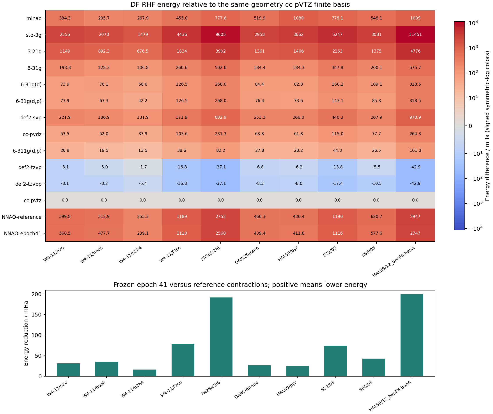
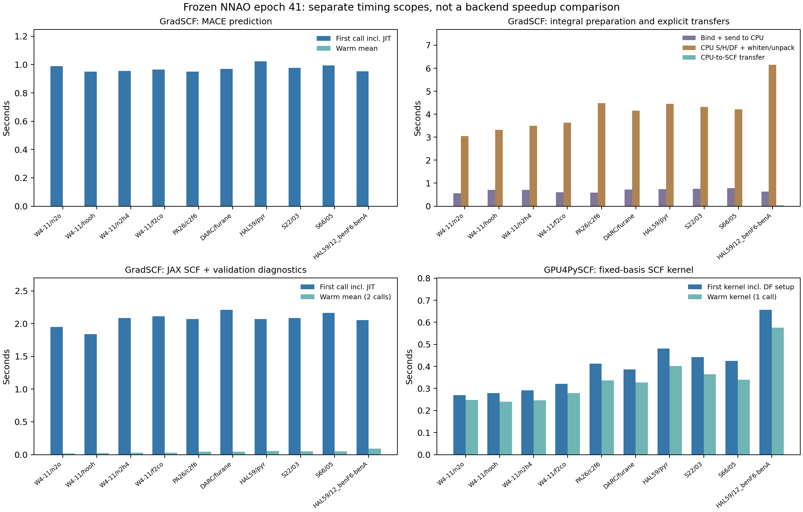

# 冻结 NNAO 的独立 HF 测试

**共享 MACE 模型仅训练到第 41 轮；本次冻结权重推理，没有基组重新拟合、梯度计算或优化器更新。** 选取 10 个结构，与 12 个传统基组及 NNAO-reference／NNAO-epoch41 比较。

当前结构文件与选样清单的哈希及 ID 顺序一致。按选样记录，结构 ID、坐标签名及整体分子式均排除了 200 个训练结构、50 个验证结构、24 个 pilot 结构和此前苯胺单体系训练。这不保证片段、化学图或反应关联的隔离；例如测试二聚体的单体可能已在训练数据中出现。

有效能量 **140/140**；0 项失败，0 项尚无结果。失败、缺失或后端不一致的计算不计入能量得分。

统一使用 RHF／密度拟合、球谐 AO、float64、辅助基 `def2-universal-jkfit`。几何相同，SCF 均从 hcore 开始；能量阈值 1e-12 Ha、梯度阈值 1e-9、最多 200 次迭代。必要时用 level shift 稳定化，撤回后重新收敛才接受。

| 结构 | NNAO AO / primitive AO / Fock | Reference − cc-pVTZ / mHa | Epoch41 − cc-pVTZ / mHa | Reference → epoch41 降低 / mHa | 有效计算 |
|---|---:|---:|---:|---:|---:|
| W4-11/n2o | 30 / 135 / 30×30 | 599.84 | 568.54 | 31.29 | 14/14 |
| W4-11/hooh | 28 / 114 / 28×28 | 512.94 | 477.72 | 35.22 | 14/14 |
| W4-11/n2h4 | 36 / 138 / 36×36 | 255.28 | 239.14 | 16.14 | 14/14 |
| W4-11/f2co | 40 / 180 / 40×40 | 1188.54 | 1109.51 | 79.04 | 14/14 |
| PA26/c2f6 | 80 / 360 / 80×80 | 2751.77 | 2560.11 | 191.66 | 14/14 |
| DARC/furane | 66 / 273 / 66×66 | 466.31 | 439.37 | 26.94 | 14/14 |
| HAL59/pyr | 80 / 330 / 80×80 | 436.42 | 411.80 | 24.62 | 14/14 |
| S22/03 | 76 / 318 / 76×76 | 1190.46 | 1115.93 | 74.53 | 14/14 |
| S66/05 | 72 / 276 / 72×72 | 620.75 | 577.59 | 43.16 | 14/14 |
| HAL59/12_benF6-benA | 120 / 540 / 120×120 | 2946.72 | 2747.48 | 199.24 | 14/14 |

相对参考收缩系数，epoch41 的平均能量降低为 **72.18 mHa**，仅统计 10 个有效配对结构；正值表示降低，负值表示升高。通过验收的 native／GPU4PySCF 同基组能量最大差为 2.387e-11 Ha。

当前 NNAO 在这 10 个体系中 **10/10 能量低于 3-21G，10/10 高于 6-31G，3/10 低于 MINAO**。相对初始收缩系数平均改善 72.18 mHa，不代表达到 double-zeta 精度。模型仅训练了 41 轮，这些结果也不足以判断该基组或网络的能力上限。

参照是同几何的 cc-pVTZ 有限基组 DF-HF 能量，不能作为 CBS 或 GMTKN55 高精度标签。这批选定结构的 HF 测试不等同完整 GMTKN55 或 WTMAD2 评估。负的参照能量差仅表示低于该有限基组；能量降低不证明力、BSSE 或基组极限精度。

计时分开记录：基组绑定及送到 CPU、native CPU 积分生成、CPU 到 SCF 设备的显式传输各自计时；CPU 积分时间含 DF 白化／解包，不含后续显式设备传输。MACE 与 JAX SCF 首调用包含 JIT 编译。Native solve 计时还包含电子能量重构、重叠矩阵最小特征值、commutator 和 raw-Phi 等 JIT 内验收诊断；GPU4PySCF 首次 kernel 包含 DF 初始化，热态 kernel 重用固定基组 DF。各次 SCF 都从 hcore 独立开始。GPU4PySCF 诊断在 kernel 计时外执行，因此两个 SCF 计时范围不完全相同。计时图仅显示 epoch41，所有基组数据在 comparison.csv，未计算后端加速比。

Native 设备：`['Tesla V100-SXM2-32GB']`，作业 `95106`；GPU4PySCF 设备：`Tesla V100-SXM2-32GB`，作业 `95106`。源码、输入与选样哈希保留在原始文件及 summary.json。

## 复现与运行记录

正式作业于 2026-10-10 在 `jy_gpu_2` / Delta 的 n002 上运行，分配 V100 32GB × 1、16 个 CPU 核和 128 GiB 内存；2026-10-10 10:24:39（北京时间）退出，退出码 0。完整 native 阶段耗时 196.57 s，完整 GPU4PySCF 阶段耗时 142.56 s；这些批次耗时包含脚本准备及重复 SCF，单次分阶段计时见 CSV。原始模型检查点 SHA256 不变。

在集群正式 GradSCF 目录中提交下列实验脚本；脚本先执行 N₂O 一致性检查，通过才运行完整测试，使用节点本地 CUDA/CuPy 缓存，且不改训练任务：

```bash
cd /home/user_yuanjiao/private/homefile/GradSCF
sbatch artifacts/nnao-heldout-benchmark-20261010/run_benchmark.sbatch
```

`job.json` 保存分配、检查点和源码身份；`job-95106/` 保存参数基组、逐项结果、源文件快照和退出状态。两次初始诊断作业分别遇到 benchmark 设备放置错误、共享 CUDA 缓存锁等待，其结果与正式性能记录分开保留，未改生产源码或训练检查点。





原始输入：`/Users/jiaoyuan/Documents/GitHub/GradSCF/artifacts/nnao-heldout-benchmark-20261010/job-95106/native/forward.json`、`/Users/jiaoyuan/Documents/GitHub/GradSCF/artifacts/nnao-heldout-benchmark-20261010/job-95106/gpu4/comparison.json`。
