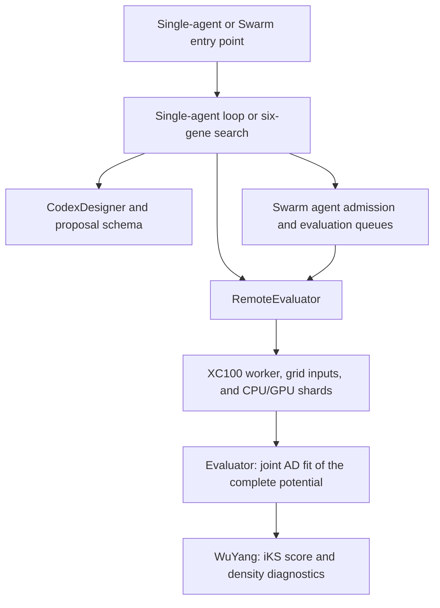

# Analytic XC design with a fixed Python evaluator

The Python controller owns the experiment. An optional Codex thread proposes a
formula, GradSCF evaluates it, and the controller records the result and feeds
back aggregate diagnostics. The core uses the Codex SDK and GradSCF's shared
XC and iKS implementations.

| Module | Responsibility |
| --- | --- |
| `candidate.py` | Immutable formula/parameter contract, safe arithmetic parser, JSON schema and digest |
| `codex.py` | Optional official `openai_codex` thread, structured replies, resume and transport timeout |
| `loop.py` | Shared AD parameter fitting, fixed-batch evaluation, acceptance and feedback |
| `bindings.py` | Grid evaluation and AO projection of local model potentials, including parameter pullbacks |
| `selection.py` | Wu–Yang-first incumbent selection and density diagnostics |
| `history.py` | Source/configuration fingerprint, append-only records and atomic proposal checkpoints |
| `dft/iks/wu_yang.py` | Physical fixed-target score and shared occupied-subspace response |

## XC100 experiment and Swarm



The dataset-specific worker lives in [`workflows/xc100/`](workflows/xc100).
Its `campaign.py` handles the experiment and fit, `molecule.py` and
`ingredients.py` bind XC100 data and features, and `parallel.py` and
`schedule.py` manage the Slurm affinity masks and persistent shards.
`distributed.py` exchanges candidates and results with the worker.

The [`swarm/`](swarm) subpackage owns the six-gene representation and crossover
(`genome.py`), generation coordination and independent lineages
(`search.py`), mutation policy (`ppo.py`), and FIFO scheduling (`queues.py`).
An agent holds one seat through a complete segment. The first ready
candidate runs on the shared numerical pool. Agent queue time, numerical
queue time, and worker-reported evaluation time are recorded separately.
The CPU allocation charge multiplies the worker-reported time by the pool's
thread count.

Run `python -m gradscf.model.autoxc.workflows.xc100.swarm` for agent count,
active segments, GA, and PPO. The single-agent workflow runs through
`python -m gradscf.model.autoxc.workflows.xc100.single`. Shared XC100 prompts
and the worker configuration ship with the workflow package. Use
[`swarm_campaign.json`](workflows/xc100/swarm_campaign.json) as the worker's
`campaign.json` to set `unbounded_waits=true` and `max_seconds=null`.
Swarm waits for completion or an explicit failure. Slurm resource limits
and SSH connection recovery still apply. The scripts
`examples/iks/xc100_swarm.py` calls the swarm entry point.
`examples/iks/xc100_open_xc.py` calls the single-agent controller. Pass
`--candidate-mode open_xc` to select the joint scoring mode below.

### XC100 joint scoring

Set `"candidate_mode": "open_xc"` and `"objective": "wy_energy"` in the
worker's `campaign.json`. The worker accepts a complete local XC potential
built from density, density gradient and Laplacian features. The inner fit
maximizes the raw Wu–Yang score with the XC potential evaluated at the fixed
target density.

After fitting, the worker reuses the output density of the final Wu–Yang
solve for each molecule. It evaluates the proposed potential along the
straight path from zero to that density using 96-point Gauss–Legendre
quadrature with a cubic change of variable. Each grid block contributes

    E_Q[rho_out] = integral rho_out(r) * integral_0^1 v_xc[t*rho_out](r) dt dr

The path scales the raw density, gradient and Laplacian together before
constructing proposal features. The submitted potential defines the gauge, so
its low-density limit matters. The result is a path-specific energy for a
general proposed potential.

The outer search takes the mean, over molecules, of

    0.5 * (W - W_PBE) / (Ne * G_scale)
    + 0.5 * (1 - abs(E_Q - Exc_TZ) / (Ne * E_scale))

`G_scale` is the mean PBE Wu–Yang gap per electron. `E_scale` is the mean
PBE XC absolute error per electron against the XC100 `Exc_TZ` label, with
PBE energy evaluated on its own Wu–Yang output density. Both scales are
fixed during worker preparation, giving PBE a joint score of zero. The
worker records the raw Wu–Yang improvement, XC energy and energy error
alongside the joint score.

## Physical evaluation

```python
problem = iks.WuYang(target, kinetic, base_fock, baseline=baseline_vxc, grid=grid)
score = problem.score(candidate_vxc)
# Alternatively: complete scalar XC energy(params, D), including any baseline.
score = problem.assess(xc_energy_fn, params)
```

`base_fock` is **T + Vext + J[Dtarget]**. Both `baseline` and the argument of
`score` are **complete XC potentials**, added exactly once. The target AO
convention, overlap, grid and all matrices must match. Cartesian embeddings of
spherical datasets must not enlarge the orbital variational space.

RKS uses the spin-summed density and occupation two; UKS keeps fixed alpha/beta
counts and independent constant gauges. Complex/nonlocal GKS is explicitly
outside this local Wu–Yang interface; the older fixed-reference GKS assessment
remains separate. All quantities are in atomic units. For candidate F = base+Vxc,

    Es = Tr(F Dcandidate)
    W  = Es - Tr((F-T) Dtarget)
    G  = Tr(F Dtarget) - Es
    reward = (W - Wbaseline) / (Ne * energy_scale)

Delta W is computed through spectral-energy differences and the candidate XC
change to reduce cancellation. `energy_scale` defaults to 1e-3 Ha. It is a
normalization choice, not a physical accuracy threshold. Internal degeneracy is
allowed; an occupied/virtual gap must exceed `gap_tolerance` (default 1e-7 Ha).
The shared solver handles subspace response; no single-orbital AD is introduced.

Preparation owns its baseline and overlap transform. There are no process-global
or object-id caches. `score` and `assess` retain JAX parameter derivatives;
Python/JSON conversion happens only at the reporting boundary. An invalid
candidate has `valid=False` and NaN reward. Optional relative grid density error
is reported independently; unrequested error is NaN, not a measured zero.

Grid diagnostics now include `density_l1 = integral |delta rho| / integral
|rho_target|` and `density_error = sqrt(integral delta rho^2 / integral
rho_target^2)`. Both use one blocked AO pass and the already-solved density.
`WuYangScore.reward` remains the raw physical Wu–Yang improvement. Workflows
may compose a separate outer reward through `iks.objectives.wu_yang_density_loss`
using explicit frozen normalization scales and weights; they must preserve
the raw metrics and identify the inner objective separately.

For an external local field, `problem.local(field_fn, params)` reuses the existing
blocked `iks.Potential`. The callback receives parameters and coordinates and
returns `(points,)` RKS or `(2,points)` UKS potential values. Its external input
provider evaluates descriptors at the fixed target. An AOGrid in the identical
target AO convention is required. Parameter-affine AO directions can instead be
prepared once in `bind`; arbitrary nonlinear fields are not silently cached.

This score needs neither inverse orbitals nor a teacher potential. It does not
run candidate SCF, certify a unique continuum potential or assess the final SCF
density. The older `iks.reward` and `iks.invert` retain their existing contracts.

## Candidates and existing custom_xc

```python
candidate = autoxc.Candidate(
    'a*n**2', kind='energy',
    parameters=(autoxc.Parameter('a', 0., -.5, .5),),
    hypothesis='Test a small density-dependent energy correction.')
functional = candidate.functional(input_fn)
```

An energy candidate evaluates an energy density, integrated with explicitly
supplied `weights` through the existing `dft.custom_xc`. `input_fn` receives
`dft.DensityInputs`, so features remain external and depend on the trial density.
Neural or traditional scalar energy callbacks can go directly to `assess`;
they need not be serialized as analytic candidates. Existing Trainer modes are
unchanged. In particular, design rounds do not add a fourth training mode.

Potential-only candidates define a local potential in Ha. They are evaluated
through `score` or `local`, and are not assigned an invented XC energy. No hidden
baseline, clipping, floor, spin convention or regularization is inferred. Feature
units, domain and any smooth vacuum treatment belong to the declared input/model.

The parser permits scalar arithmetic, bounded literal powers and a small set of
JAX math functions. It rejects Python execution, attributes, indexing and imports.
Formulas and optional ordered `definitions=[{name, expression}, ...]` share a
16000-character/2048-node budget, with depth64 per expression. Definitions may
refer only to preceding definitions. There is no fixed term or parameter-count
limit. Dynamic exponents and nonlinear parameters are supported; fixed literal
exponent magnitude is bounded by eight. Unsafe Python syntax remains rejected.

`bind_local_potential(problem, grid, candidate, sampled_inputs, ...)` binds
arbitrary scalar physical inputs to a local potential. It reuses the core AO
projection and its physical transpose. Affine candidates cache integral panels
only when the raw AO/dtype budget permits; others recompute sampled fields and
use staged pointwise/physical VJPs. Model parameters are dynamic inputs, not a
reason to recompile each optimizer step. Optional `transform` transports grid
AOs to the target AO representation. This prepared analytic binder is real
RKS; RKS/UKS callable/neural local fields continue to use `WuYang.local` and
may have arbitrary parameter PyTrees.

Shared `iks.prepare_orbital_reference` and `iks.orbital_grid_features` provide
real RKS/UKS occupied density, tau and smooth energy-filtered virtual densities.
Reference preparation is explicitly frozen/offline and rejects traced Fock
inputs. Supplied coefficient/energy/grid leaves retain feature derivatives.
No full grid-by-orbital cache is constructed; phase/permutation and equal-energy,
equal-occupation rotations preserve the scalar descriptors. A live
candidate-dependent reference requires a separately defined response contract.

## Deterministic evaluator and loop

`bind(candidate)` returns a fixed mapping from sample IDs to `score_fn(params)`.
Each score function must return `iks.WuYangScore`. `Evaluator` fits coefficients
with JAX value/grad and the shared bounded `minimize_eager` solver. Any invalid
sample invalidates the whole candidate; no failed molecule is omitted to improve
the mean reward. Failed fits never become negative-infinity optimization targets.
An optimizer iteration limit is retained in the fit report, not called convergence.
Set `gradient_only=True` to disable objective-change convergence and certify
the projected-gradient infinity norm at the returned parameters. With bounds,
this is `max(abs(x - clip(x-gradient, lower, upper)))`; the raw gradient is also
recorded. `require_convergence=True` makes an unresolved fit invalid. The
iteration limit remains a resource guard, and neither flag changes the defaults
of existing callers.
An optional `max_seconds` checks the elapsed fitting budget at optimizer
evaluation boundaries; exhaustion is invalid, not convergence. Opaque kernels
cannot be interrupted by that Python check.
An optional `score_fn.diagnose(params)` runs expensive grid diagnostics once
after fitting. Its W/DeltaW/reward must agree with the matrix score, and its
validity also gates the final candidate. The fit never repeats that grid pass.

```python
evaluator = autoxc.Evaluator(bind, sample_ids=train_ids + validation_ids,
    fit_ids=train_ids, reward_ids=validation_ids, fingerprint=experiment_digest)
result = autoxc.run(designer, evaluator, directory='runs/xc-design', rounds=5,
                    context=design_brief)
```

`fit_ids` and `reward_ids` are explicit and frozen. They default to the complete
batch, supporting training-reward selection as well. Sealed tests must remain
outside this evaluator and all proposal feedback. After freezing the winner,
the caller may evaluate it once on a separate held-out batch without refitting.
No split or fixed list of molecules is embedded in the library.

For strict iKS use the raw WY reward in both fitting and formula selection.
Optional `WYSelection(density_scales=(mean_PBE_L1, mean_PBE_L2_squared))` accepts
clear WY improvements first; within its tolerance, density can break a tie only
without decreasing WY. `run(..., selection=policy)` records the policy and
secondary state for deterministic resume. An energy label is not required.

`fingerprint` must identify the dataset/target, AO and grid conventions, callback
code, baseline, score scales and physical gates. The controller additionally
hashes the complete GradSCF Python source tree (including indirect shared
numerical dependencies) and records numerical/SDK versions and JAX's default
backend/float64 setting. A changed experiment
requires a new run directory. The caller remains responsible for updating an
external callback/data fingerprint when its semantics change, including native
backend builds not represented by Python source. Native binaries and raw data
are not read or copied by the source fingerprint.

The JSONL ledger retains every attempt, raw reply, exact formula/bounds,
fitted parameters, per-sample W/DeltaW/G/gap/error/validity, fit status, errors,
elapsed time and thread ID. An SDK error is a proposal failure, not a low score.
Feedback contains only formula/aggregate results; raw matrices and sample IDs
stay in local records. Checkpoints are atomic; completed replies survive an
interruption during evaluation. Restart with the same directory and a larger
**total** round limit. Completed rounds are not repeated. A reply not yet saved
when the process dies may need another model turn. Use one controller per run
directory; concurrent writers and automatic repair of a torn ledger are unsupported.

## Codex and verification boundaries

The optional `autoxc` extra installs `openai-codex>=0.147.0` and SciPy. SDK imports
are lazy. Creating/importing `CodexDesigner` does not authenticate or launch a
runtime; entering its context does. The SDK owns its pinned runtime and normal
authentication. No credential discovery, custom transport or endpoint probing
is implemented here.

```python
with autoxc.CodexDesigner(cwd=proposal_directory, model=model, effort='high') as designer:
    result = autoxc.run(designer, evaluator, directory=run_directory, rounds=5)
```

The proposal thread is read-only. That prevents evaluator edits, but does not
itself prevent reads of accessible held-out data: deployment must isolate such
data from the SDK process. A watchdog closes the official SDK runtime on a turn
timeout, preserving its thread ID; it uses no Unix signal handlers. A restart
restores the saved session through the SDK. An unfinished model turn and the
controller's last committed numerical result remain distinct states.

`examples/iks/agent_loop.py` runs three replayed proposals on a manufactured
two-AO quadrature. Fits and scores are real calculations. This is an executable
interface/restart example, not a molecular accuracy result or a live agent search.
The current verification uses CPU float64, fake SDK clients and array/quadrature
systems. Live SDK authentication, molecular XC100 runs, GPU execution and process
isolation enforcement are not claimed by those tests.

Subsequent acceptance now includes [one actual XC100/Codex loop](../../../../examples/iks/XC100_CODEX_SINGLE.md):
BH3 at the original cc-pVTZ/grid-5 settings, two live Luna/high proposals and
independent PBE checks. The original manufactured tests and that molecular
receipt remain separate. No generalization, GPU or candidate SCF claim follows.
